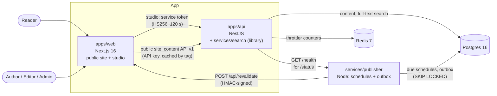
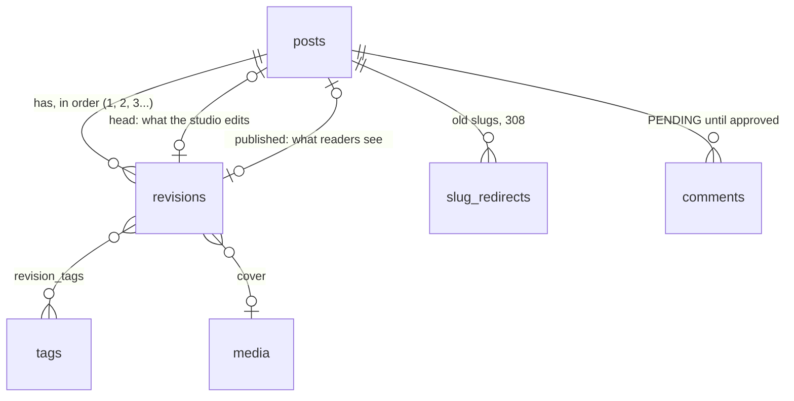
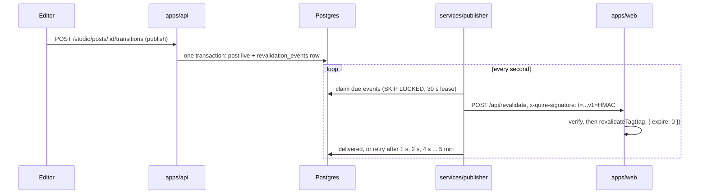

# headless-cms: markdown in, static pages out, updated the moment an editor publishes

[](https://github.com/bastian-red/headless-cms/actions/workflows/ci.yml)

A headless content system with its own public blog. Authors write markdown in a studio, editors
review, schedule and publish, and the public site serves every post as a static page that is
revalidated by tag the moment a publish lands, with no rebuild. A versioned content API serves the
same published content to any other frontend, and the public site reads through it like any other
client. Nothing unpublished may ever reach a page, a feed, a sitemap or a search result.

> **Status: build step 10 of 11, the design.** Sign-in, the three roles, the publisher process,
> health and status, every test lane and CI are in place, and so are the content schema, a seeded
> demo publication of forty posts, the one sanitizing markdown renderer, the API (posts and
> revisions with stale-save conflicts, the editorial workflow, content API v1 and API keys),
> full-text search, the public site (every post, tag and author page prerendered from the content
> API, the feed, the sitemap, JSON-LD and a social card per post), the publisher (scheduled
> publishing and signed revalidation webhooks, so a publish reaches every cached page in about a
> second and a half), readers' comments (moderated before anyone sees them, rendered inside the
> static post page), the studio (a CodeMirror editor with a live preview from the site's own
> renderer, stale-save conflicts shown as a diff, revision history with restore, the workflow
> buttons, the moderation queue, people and API keys), and the visual identity: Quire set as a
> foundry type specimen ([Design](#design-a-type-specimen)). Step 11 adds Lighthouse budgets and
> the demo GIF. Nothing below describes a feature that is not in the code.



The browser only ever talks to `apps/web`. The web tier holds no database credentials (a lint rule
refuses `@cms/db`, Prisma, Redis and BullMQ imports there), so every read of content goes through
the same API an outside client would use.

## What is in the scaffold

- **Sign-in, no sign-up.** Accounts are made by an admin; a public sign-up form on a newsroom's
  tool is an open door. Auth.js keeps the session in a cookie, and the API answers
  `POST /auth/sign-in` after the same scrypt work for an unknown address as for a wrong password,
  so the answer cannot be read off the clock.
- **Three roles as data.** `AUTHOR`, `EDITOR`, `ADMIN` and what each may do live in one table in
  `packages/shared/src/contracts/roles.ts`, read by the API, the studio and the tests. The studio
  shows the role the API reads from Postgres (`GET /auth/me`), not the copy in the session, so a
  demotion takes effect on the next page load.
- **Default-closed API.** Every route needs a service token unless it is marked `@Public()`.
- **Rate limits scoped to what they protect.** Sign-in is capped at 5 a minute per address and
  comments (from step 8) at 10. The tests prove the sign-in budget limits sign-in and nothing else,
  because `@nestjs/throttler` v6 applies every named budget to every route unless it is skipped.
- **Operability.** `GET /health` on the API runs a real `SELECT 1` and `PING`; the publisher's
  checks Postgres, the outbox backlog (red once an event is 5 minutes undelivered, with the last
  error) and overdue schedules (red once a post is a minute late). Both answer 503 naming the
  failing check, and `/status` shows both, fed by the API.
- **Static pages that stay static.** `scripts/render-check.mjs` reads the build's prerender
  manifest and fails the E2E lane if any route leaves its planned row in the rendering matrix
  (below). That is the failure a single `cookies()` call in a shared layout causes: the build still
  succeeds and every content test still passes, so only the manifest can see it.

## The content model

Content is data, not pages. A **post** is an identity: its slug, its workflow state and two pointers.
Everything a reader sees lives in a **revision**, and revisions are immutable.



- **Readers see the published revision, never the newest one.** A live post being edited is in
  `DRAFT` while readers keep reading the old revision. Tags hang off the revision, so retagging a
  draft cannot change a public tag page before the draft is published.
- **The database enforces the rules, not only the API.** Each of these is a constraint or trigger,
  and `packages/db/test/schema.test.ts` attempts every forbidden write against a real Postgres and
  asserts it is refused by name:
  - a revision cannot be updated, and cannot be deleted while its post exists;
  - a post's head and published revisions, and a revision's parent, must belong to that post;
  - `PUBLISHED` means the head is live, `UNPUBLISHED` means nothing is, `DRAFT` / `IN_REVIEW` /
    `SCHEDULED` mean there is pending work, and a scheduled time exists exactly when scheduled;
  - two saves from the same base cannot both become revision n+1;
  - a redirect can never shadow a live slug, from either side, even when the two writes race (an
    advisory lock per slug; the test proves the second writer waited);
  - slug format and every length limit, with the numbers pinned to `@cms/shared` by a gate test.
- **The seed is a fixture, and it is checked.** Forty posts in every workflow state (one of them
  3,400 words), history, a renamed post with its redirect, a deliberately hostile post, and comments
  in every moderation state. Every row readers must never see carries a canary word.
  `./scripts/seed-check.sh` seeds twice and fails unless both runs digest identically, no canary is
  in any row the public site may read, and every internal link in a live post resolves.

## One markdown renderer

`packages/markdown` is the only code that turns markdown into anything. The studio preview, the post
page, the RSS feed and the search index all call its `render()`, so an editor previews exactly what
a reader and a feed reader get.

```
source ─ remark-parse + GFM ─ headings shifted below the page's h1 ─ remark-rehype ─┐
         (raw HTML dropped here, never escaped into the page)                       │
  ┌─────────────────────────────────────────────────────────────────────────────────┘
  └ rehype-sanitize (GitHub's schema, narrowed) ─ heading ids, footnote links, lazy images
    ─ audit: an independent walk that throws on any unsafe node ─ tree
         ├─ toReact()    page and studio preview: React elements, no innerHTML anywhere
         ├─ renderHtml() RSS (with absolute URLs)
         └─ text         search index
```

- **Sanitized, then audited.** `rehype-sanitize` removes everything outside the policy, and a
  separate audit (`src/audit.ts`, which reads URLs the way a browser does, control characters and
  tabs included) refuses the tree if anything got through. A pipeline that lost its sanitizer
  fails to render instead of serving script; a test proves it.
- **Tested against what a browser would parse.** 46 hostile vectors (raw script, `onerror`,
  `javascript:` with mixed case, entities, tabs and control characters, reference links, attribute
  break-outs, mutation-XSS shapes) plus a property test over random hostile markdown. Each output
  is re-parsed by parse5 and must hold nothing executable and give back exactly the tree that was
  serialized. The seeded hostile post renders to a reviewed snapshot.
- **The same document everywhere.** For every seeded post and every vector, the React path and the
  HTML path parse to the same document. That check found a real difference (`data-footnotes`
  rendered as `="true"` by React and bare by the HTML serializer), now settled in the renderer.
- **No DOM clobbering.** An element id becomes a property of `window`. Heading ids come from the
  shared `slugify` (`[a-z0-9-]`, so `## __next_f` gets `next-f`), and footnote ids carry the
  sanitizer's `user-content-` prefix exactly once, so footnote links work with no script.
- **A time limit on save.** The parser is not linear on every input. Measured: 16,000 characters
  of alternating emphasis take 8 s, 400 nested list levels take 4.8 s, and 8,000 nested quotes
  overflow the stack. `@cms/markdown/server` renders a body in a worker thread with a 2 s
  deadline and terminates it on overrun. From step 4 the API refuses to save a body that fails,
  so pages only ever render bodies that finished in time.

## The API

Two audiences, two front doors, one rule underneath: every write locks the post row and checks the
revision the client says it started from.

### Studio API (`/studio`, signed in)

| Route                                                          | Needs                      | What it does                                                                                              |
| -------------------------------------------------------------- | -------------------------- | --------------------------------------------------------------------------------------------------------- |
| `GET/POST /studio/posts`                                       | `post.read` / `post.write` | List (an author sees only their own), create with revision 1                                              |
| `GET /studio/posts/:id`, `.../revisions`, `.../revisions/:rid` | `post.read`                | The post with its head, the history, one revision                                                         |
| `POST /studio/posts/:id/revisions`                             | `post.write`               | Save: `baseRevisionId` + fields. 201 new head, 200 nothing changed, 409 stale, 422 does not render        |
| `POST /studio/posts/:id/revisions/:rid/restore`                | `post.restore`             | Restore = a new revision with the old content; history is never rewritten                                 |
| `PUT /studio/posts/:id/slug`                                   | `post.write`               | Rename; renaming a post that was ever public is an editor's call and leaves a 308 behind                  |
| `POST /studio/posts/:id/transitions`                           | per action                 | `submit`, `withdraw`, `publish`, `schedule`, `unschedule`, `unpublish`, pinned to the head the caller saw |
| `GET/POST /studio/tags`                                        | `post.read` / `tag.manage` |                                                                                                           |
| `GET/POST /studio/users`, `PATCH .../:id/role`                 | `user.manage`              | The last admin cannot be demoted                                                                          |
| `GET/POST/DELETE /studio/api-keys`                             | `apikey.manage`            | A key is shown once and stored as a SHA-256                                                               |
| `GET /studio/comments?status=&cursor=`                         | `comment.moderate`         | The moderation queue: pending oldest first, with how many came from the same (hashed) source              |
| `POST /studio/comments/:id/decision`                           | `comment.moderate`         | `{ from, to }`: approve, reject or mark spam; 409 with the current state if somebody decided first        |

- **A stale save is a 409 that says what happened.** Five editors saving from the same base:
  one wins and four get `409` with the winning revision, the fields that differ and a unified diff
  of the body (`details.bodyPatch`). The row lock (`SELECT ... FOR UPDATE`) is what makes that
  answer possible: without it the losers hit the unique revision number instead and learn nothing.
- **A body that does not render in time is a 422, before anything is written.** Every save and
  restore runs the body through `@cms/markdown/server`'s `RenderPool` (two workers, a 2 s
  deadline each). A pathological body is refused with `details.render: "timeout"` and the next save
  works, so a post can never hold a body the page cannot render.
- **An editor publishes exactly what they reviewed.** A transition names `revisionId`; if the head
  moved since, it is a 409 and nothing changes. Publishing needs an excerpt (it is the feed
  summary and the meta description), a schedule must be at least a minute ahead, an author's save
  cannot touch a scheduled post, and an editor's save cancels the schedule.
- **Somebody else's post is 404, not 403**, for an author, on every route.
- **The role is read from the database on every request**, never from the token, so a demotion
  takes effect on the next call rather than when the two-minute token expires.
- **Every change readers can see writes its cache tags in the same transaction.** Publish,
  unpublish and renaming a live post insert a `revalidation_events` row (`posts`, `post:<slug>`,
  `tag:<slug>`, `author:<id>`) that the publisher delivers. A save or a submit writes none: nothing
  public changed.

### Content API v1 (`/v1`, API key)

`Authorization: Bearer hcms_...`, issued by an admin in the studio. Missing, malformed, unknown,
revoked and studio-token credentials all get the same 401.

| Route                                       | Answer                                                                                                                                                                               |
| ------------------------------------------- | ------------------------------------------------------------------------------------------------------------------------------------------------------------------------------------ |
| `GET /v1/posts?tag=&author=&limit=&cursor=` | Live posts, newest first, keyset-paginated (`nextCursor`), each with its words and reading time so a list can be chosen from by length                                               |
| `GET /v1/posts/:slug`                       | The published revision as markdown and as sanitized HTML, with outline, words and reading time; `308` + `Location` from an old slug; `410` if taken down; `404` if it never went out |
| `GET /v1/posts/:slug/comments`              | Approved comments on a live post, oldest first, plain text, keyset-paginated                                                                                                         |
| `GET /v1/tags`                              | Tags on at least one live post, with counts                                                                                                                                          |
| `GET /v1/search?q=&limit=&cursor=`          | Live posts matching `q`, title hits first, with `total` and a snippet as data; see [Search](#search)                                                                                 |
| `GET /v1/openapi.json`                      | The OpenAPI 3 document, public, generated from the same zod schemas the tests parse responses with                                                                                   |

- **Drafts have no road out.** Every query reads `published_revision_id`; nothing in the content
  service selects the head. The integration suite crawls every page, post and tag for the seed's
  canary words and fails on one, including on the post whose pending draft holds them.
- **`ETag` on every 200**, `304` on a matching `If-None-Match`, `Cache-Control: no-cache`.
- **Per-key rate limits.** A key is its own budget, so the public site and a second frontend
  never share one.
- **A draft and nothing at all answer byte for byte the same 404**, so the API does not disclose
  what is being written.

## Search

`GET /v1/search?q=edge+caching` answers from Postgres full-text search, in the database the content
already lives in ([`services/search`](services/search/README.md) has the whole design and its
measurements):

```json
{
  "query": "edge caching",
  "total": 2,
  "nextCursor": null,
  "items": [
    {
      "slug": "caching-at-the-edge-a-year-in",
      "title": "Caching at the edge, a year in",
      "...": "...",
      "snippet": [
        { "text": "A year ago we put a ", "match": false },
        { "text": "cache", "match": true },
        { "text": " in front of every public", "match": false }
      ]
    }
  ]
}
```

- **Only published text can match**, held three ways: the database keeps each revision's
  document `live` exactly while it is the published one (triggers, a forged flag is undone), the
  query also joins the published pointer, and the API keeps a hit only if it still is.
- **What is indexed is what readers read:** the renderer's text, never the markdown source, so the
  hostile post's `<script>` payload is not findable.
- **A title match always outranks a body-only match.** It is the first sort key, not a weight,
  because weights alone invert (the suite builds the case).
- **The query syntax readers already type:** `"a phrase"`, `or`, `-without`, never a syntax
  error. Snippets are `[{ text, match }]`, so no client has to trust HTML from a search result.
- **p95 33 ms over 2,000 published posts** (`pnpm search:bench`, a CI step, budget 50 ms), with
  the common words matching every post. The first design measured 513 ms; the README in
  `services/search` says what each step bought.

## The public site

The public blog, "Quire", is a client of the content API like any other: it holds an API key
(`CONTENT_API_KEY`, registered by the seed) and no database access. Every read is a `fetch` that
Next caches and tags with the names in `packages/shared/src/contracts/revalidation.ts`
(`posts`, `post:<slug>`, `tag:<slug>`, `author:<id>`), the same names the API writes into its
revalidation events, so a publish can invalidate exactly the pages that show it.

### Rendering matrix

Read from the build, not asserted from memory: `scripts/render-check.mjs` compares
`.next/prerender-manifest.json` with this table in the E2E lane, and fails it on any drift.

| Route                                               | Strategy                                                                             | Why                                                         |
| --------------------------------------------------- | ------------------------------------------------------------------------------------ | ----------------------------------------------------------- |
| `/`, `/posts`, `/tags`, `/feed.xml`, `/sitemap.xml` | Static, revalidated by tag (1 h safety net)                                          | Same bytes for every reader until something is published    |
| `/posts/[slug]`, `/tags/[tag]`, `/authors/[id]`     | Every known value prerendered; a new one rendered once on first request, then cached | A post published after the build needs no rebuild           |
| `/posts/[slug]/card.png`                            | Prerendered per post, like the page                                                  | The social card is an image crawlers fetch once             |
| `/robots.txt`                                       | Static                                                                               | No data                                                     |
| `/search`                                           | Per request, `noindex, follow`                                                       | Every query is different, and a results page is not content |
| `/studio`, `/sign-in`, `/status`                    | Per request                                                                          | They read the session or live service state                 |

Classic ISR rather than Cache Components (`cacheComponents`): with it on, the studio, sign-in and
status routes would become partial-prerender shells too, and the manifest would no longer say in
one word what each public route is. `revalidate = 3600` on every content route is the safety net
for a lost revalidation event, and a gate test holds every route, the loader and the checker to the
same number.

The build also proves its content: the E2E lane builds against the seeded API, then checks that
all 36 live posts were prerendered and scans every file under `.next/` for the draft and comment
canaries (with the long-form post as the positive control, so a scan that read nothing fails).

### Technical SEO

- **Every indexable page** has its own title and description, a canonical URL to itself, the feed
  link, and no `robots` meta. The E2E lane walks the sitemap and checks each one, with no two pages
  sharing a title or a description.
- **JSON-LD:** `BlogPosting` and `BreadcrumbList` on posts, `BreadcrumbList` on listings, `WebSite`
  with a `SearchAction` on the front page. It is written as the script's text child, never raw
  HTML, with `<`, `>`, `&`, U+2028 and U+2029 escaped, so no title can end the element; a hostile
  title round-trips in the gate lane.
- **Dates that agree:** the sitemap's `lastmod`, `dateModified` and `article:modified_time` are
  all the later of the first publish and the shown revision, so a revision written before the post
  went live never makes it look modified before it was published.
- **The social card** is a 1200×630 PNG per post at `/posts/<slug>/card.png` (`next/og`),
  referenced by Open Graph and `summary_large_image`. A route handler, not `opengraph-image.tsx`,
  so its address is stable and it prerenders.
- **RSS 2.0** with the newest 20 posts in full: the same renderer as the page, URLs made absolute,
  `]]>` split across CDATA sections, characters XML forbids removed, and `lastBuildDate` taken from
  the newest post so the same content gives the same bytes.
- **Old slugs answer 308** to the current one; a missing or taken-down post is a 404 and leaves
  the sitemap and the feed. `robots.txt` keeps crawlers out of `/studio`, `/preview`, `/sign-in`
  and `/api/`.

Next 16.4.1 sent `Location` twice on the first render of an on-demand redirect (it sets the header
while rendering, then replays the cache entry's headers onto the same response).
`patches/next@16.4.1.patch` skips a replayed header the response already carries with the same
value, and the E2E lane asserts exactly one `Location` on a fresh build.

## Comments: moderated first, rendered static

Anyone can comment with a name and no account. Nobody sees a comment, not even its writer, until an
editor approves it, and then it is part of the static post page, not something a browser fetches.

- **The form works without JavaScript** (a server action), says in words that the comment is
  waiting for an editor, names the field it refuses, and keeps what was typed.
- **Plain text only.** A comment is stored normalized (line endings, no control or
  direction-override characters, at most one blank line) and rendered as text nodes split into
  paragraphs, so it cannot carry a link, an image or markup, and needs no sanitizer to be safe.
- **Three layers against spam.** A honeypot field (off-screen, out of the tab order, hidden from
  assistive technology) that is answered exactly like a real comment and stored nowhere;
  `RATE_LIMIT_COMMENT` (10 a minute) per address, which limits that route and nothing else; and an
  editor reading every comment first.
- **No address is kept.** The comment row stores `addressHash` (HMAC-SHA256 under `AUTH_SECRET`),
  and the rate limiter's Redis keys use the same hash, so neither holds an address in the clear.
  The moderation queue shows how many pending comments came from the same source instead.
- **Two editors cannot both decide.** A decision names the state the moderator saw (`from`), and
  the UPDATE repeats it in its WHERE: of two at once, one lands and the other gets 409 with the
  state it is in now.
- **A decision readers can see refreshes the page through the publisher.** Approving, or taking
  back an approved comment, writes a `comments:<slug>` revalidation event in the same transaction;
  rejecting or marking a pending comment as spam writes none. The page's comment read is tagged
  `comments:<slug>` alone, so the post's own read stays cached. Measured in the E2E lane: an
  approval is on the cached page in 1.9 s, a refusal gone in 0.7 s.
- **Counted in words and in JSON-LD:** "No comments yet", "1 comment", "2 comments", and
  `commentCount` on the `BlogPosting`.

## The studio

`/studio`, behind sign-in, server-rendered per request. Every write is a server action, so every
form works before JavaScript loads; the browser never calls the API, and the API checks the role
from its own table on every call (hiding a link is a courtesy, not the boundary).

| Route                        | Who           | What it is for                                                                              |
| ---------------------------- | ------------- | ------------------------------------------------------------------------------------------- |
| `/studio`                    | everyone      | Posts, newest change first, filtered by state through plain links; an author sees their own |
| `/studio/posts/new`          | everyone      | A title is enough to start a draft                                                          |
| `/studio/posts/[id]`         | everyone      | The editor (below) and the workflow buttons the API offers this role in this state          |
| `/studio/posts/[id]/history` | everyone      | Every revision; compare any of them with the current one; restore (editors)                 |
| `/studio/posts/[id]/preview` | everyone      | The saved revision in the public article body, `noindex`                                    |
| `/studio/comments`           | editor, admin | The moderation queue: waiting oldest first, then approved, rejected, spam                   |
| `/studio/people`             | admin         | Add a person, change a role (the last admin cannot be demoted)                              |
| `/studio/api-keys`           | admin         | Create a content API key (shown once), revoke one (asks first)                              |

A page a role cannot use is a 404 for that role, the same answer the API gives.

**The editor.**

- **CodeMirror 6 over a real `<textarea>`.** The textarea is the form field; CodeMirror mounts beside
  it once the page is interactive and writes every change back. Without JavaScript the same form
  saves through the plain textarea (`studio.spec.ts` saves with JavaScript off). The bare
  `codemirror` package and a 90-line hook, no React wrapper.
- **The preview is the site's renderer.** `render()` and `toReact()` from `packages/markdown` run in
  the browser on every edit and feed the same `ArticleBody` component the public post page uses,
  so the preview cannot drift from what is published. Side by side from 64rem; Write and Preview
  tabs on a phone.
- **A save never overwrites somebody else's.** It names the revision it started from; if another
  save landed first the API answers 409 with who saved, which fields they changed and a unified
  diff of the body, and the editor shows it. The person chooses: save theirs on top of the newer
  revision ("keep mine", an overwrite made by somebody who saw the diff) or discard theirs and
  load it. The base moves only on their own save or that choice, never because the page refreshed
  behind them.
- **Unsaved work is visible and guarded**: a status line ("Unsaved changes" / "Saved as revision
  4"), a warning before leaving, Ctrl/Cmd+S, and workflow buttons that wait for the save, because a
  transition acts on the saved revision.
- **Counters** on every length-limited field, from the same `LIMITS` the API validates with.
- **Scheduling in the editor's own time zone.** The `datetime-local` value is converted to an
  instant in the browser (the server does not know the zone) and the label names the zone.
  Without JavaScript the label says UTC, which is what the server reads. A wall-clock time the
  clocks skip (Chile, 2026-09-06 00:30) is refused instead of silently published an hour late.
- **Taking a post down asks first, in words**, with a way back ("Keep it published"); the question
  is a server round trip, so it holds without JavaScript too. Revoking an API key works the same way.

**History.** Any revision compares with the current one field by field (jsdiff: words for one-line
fields, lines for the body, tags as a set), with additions and removals marked by colour, by
underline or strike-through, and by words for a screen reader. A long unchanged body folds to the
change and two lines of context. Restoring writes a new revision; nothing is ever deleted.

Three editor bugs the E2E lane found, each now held by a test that was run red against the bug:
a browser posts a textarea with CRLF line endings, so every form-saved body differed from the same
text in the editor until the contract stored LF (`studio.test.ts`); pushing every React value back
into CodeMirror lost keystrokes in Firefox ("First hand" saved as "Fisthad"), so only an explicit
outside change replaces the document (`studio.spec.ts`, stale-save test, Firefox); and "load
theirs" cleared its flag before the refresh it started had landed, leaving the newer revision
unloaded (same test, Chromium).

Times in the studio render in UTC, labelled, on the server and in the viewer's zone once the page
has loaded: never a bare time a reader has to guess the zone of.

## Design: a type specimen

Quire's readers arrive from a search result or a shared link, usually on a phone, with one
question: is this worth my next ten minutes? The design answers it before the first paragraph,
and then gets out of the way of a long read.

Each page is set as a foundry type specimen: one ink on specimen paper and a single spot colour,
a printer's blue. The blue marks only wayfinding and annotation, never decoration and never
status. There are no cards and no shadows: hairline rules, a double rule under the masthead,
1 px corners.

|                          | Light     | Dark      |
| ------------------------ | --------- | --------- |
| Paper (`--bg`)           | `#ebdbca` | `#2d2213` |
| Ink (`--text`)           | `#1f1a14` | `#ecdfcc` |
| Spot colour (`--accent`) | `#2e408a` | `#afb5ff` |
| Rules (`--rule`)         | `#8a7660` | `#94806a` |

**Faces.** All three are self-hosted variable woff2 files with their OFL beside them, and a build
never fetches a font.

- **Brygada 1918** sets the reading column and the titles. It is a text serif revived from a 1918
  specimen, used in roman and its real italic.
- **Libre Franklin**, a specimen-tradition grotesque, sets the label, the masthead and the studio's
  controls.
- **Reddit Mono** sets code, slugs and keys.

The palette was found by search against every sibling project. It is perceptually distant from all
of them (canvas ΔE 3.6 / 5.1, accent ΔE 12.8 / 10.6), and every pair clears WCAG AA in both
schemes.

**The specimen label.** Beside the title, in the margin, the post says how long it is, how long it
takes to read, how it is set and where its sections start:

```
SET IN         Brygada 1918 20/32, 66 characters a line
LENGTH         3,418 words
READING TIME   15 min
IN THIS POST   1 The page is built before you ask for it …
```

None of it is typed. Words and minutes come from the renderer: the same count the API stores on
each revision and serves in every list. The setting is read from the stylesheet's own tokens
(`--reading-size`, `--reading-leading`, `--measure`) and the font file `--font-text` loads.
`lib/specimen.test.ts` fails if the label and the CSS disagree. `specimen.spec.ts` then measures
the rendered column in Chromium and Firefox: 20 px type, 32 px lines, a column of 66 widths of
"0", and the named face actually loaded.

That test caught a real lie. With the margin breakpoint at 60rem, the column at 1280 px was
768 px, but 66ch of Brygada at 20 px is 792 px. The label now moves into the margin only when the
column has room for its measure (64rem), and on a phone it folds to one line ("3,418 words · 15
min · Brygada 1918 20/32") without claiming a measure it does not have. The contents fold into a
disclosure.

The sheet decides its layout by its own width (a container query), not the window's. The editor's
preview pane is narrow on a wide screen, so it shows the folded label, the same one a phone shows.

**The size index.** Home, archive, tag, author and search lists set each post's reading time as
the large numeral beside its title, so a reader can choose by length from the list itself.

**The studio** is an operate screen, and it takes the type, the ink and the label only; its
navigation, tables and forms stay the standard ones.

- The workflow panel ("is it ready, and what will the world see?") is the one panel set apart,
  with the double rule and the lighter paper.
- The editor's body and preview each scroll inside a pane one viewport tall, so the line being
  written, the save bar and its preview stay on one screen. The page used to open sixteen
  viewports tall.
- An instant and its zone ("GMT-3") never split across lines.

**Held by tests.** Each claim was proven red by breaking what it holds.

- `lib/identity.test.ts` pins the identity: canvas, accent and radius in both schemes, the three
  self-hosted faces, `theme-color` equal to the canvas, no status colour on code, no shadows.
- `lib/contrast.test.ts` checks every colour pair, plus the reason links stay underlined: the
  accent is only 1.8:1 against the ink.
- `lib/specimen.test.ts` holds the label to the stylesheet.
- `e2e/tests/specimen.spec.ts` holds the label to the rendered page, along with the size index,
  whole instants and the still editor.
- `a11y.spec.ts` runs axe on every route in both schemes, at zero violations.

## Publishing: from a button to every cached page



- **The announcement cannot get lost.** The API writes the publish and its revalidation event in
  one transaction (the outbox pattern), so a crash between "published" and "told the site" is not
  a state the database can be in. The publisher delivers from that table.
- **Scheduling is a column, not a job.** A scheduled post is `status = SCHEDULED` plus
  `scheduled_for`. Once a second the publisher takes due posts `FOR UPDATE SKIP LOCKED` and
  publishes them with their event in one transaction, so two publishers cannot publish a post
  twice and a restart cannot lose one. `published_at` is the editor's time, not the tick's. Redis
  was the other option (BullMQ delayed jobs); it would have meant a second system that has to
  agree with Postgres about every schedule, cancel and edit, so Redis keeps only rate limits.
- **At least once, safely.** A claimed event gets a 30 s lease; a publisher that dies mid-delivery
  lets it lapse and the event goes again. Expiring a tag twice costs one extra render, so the
  receiving end needs no deduplication. A failed delivery is retried with exponential backoff up to
  5 minutes and is never dropped.
- **Signed like a payment webhook.** The raw body and a timestamp are signed with HMAC-SHA256
  (`REVALIDATE_SECRET`), checked within 300 s and in constant time, and verified before the body is
  parsed. Without the secret, `POST /api/revalidate` is a 401 that touches nothing.
- **Fresh on the very next request.** `revalidateTag(tag, { expire: 0 })` expires the tag at once
  rather than serving the old page one more time while it refetches (`updateTag` would, but it
  throws outside a server action).
- **Measured.** `e2e/tests/publish.spec.ts` warms the archive, feed and sitemap, then publishes,
  edits and unpublishes a post through the API against a production build; each change is visible
  on the post page, the archive, the feed and the sitemap in 1.2-1.6 s (the test fails at 5 s). It
  goes red if the site's route answers 200 without expiring the tags.

[`services/publisher/README.md`](services/publisher/README.md) lists every guarantee with the test
that holds it and how to read its health check.

## Running it

Requires Node 20+, pnpm 9 and Docker.

```bash
pnpm install
cp .env.example .env
sed -i "s|^AUTH_SECRET=|AUTH_SECRET=$(openssl rand -base64 32)|" .env
sed -i "s|^REVALIDATE_SECRET=.*|REVALIDATE_SECRET=$(openssl rand -base64 32)|" .env
sed -i "s|^CONTENT_API_KEY=.*|CONTENT_API_KEY=$(node scripts/new-api-key.mjs)|" .env
docker compose -f infra/docker-compose.yml up -d     # Postgres :5444, Redis :6390
pnpm db:deploy && pnpm db:seed                        # registers the site's key, writes search documents
pnpm dev                                              # web :3000, api :4000, publisher :4400
```

The public site is at <http://localhost:3000>. Open <http://localhost:3000/studio> and sign in with a seeded account (local accounts for a local
database, published on purpose):

| Role   | Email              | Password               |
| ------ | ------------------ | ---------------------- |
| Admin  | `ines@quire.test`  | `admin-password-2026`  |
| Editor | `tomas@quire.test` | `editor-password-2026` |
| Author | `mara@quire.test`  | `author-password-2026` |

The whole stack in containers: `docker compose -f infra/docker-compose.yml --profile app up -d --build`.
It takes the same ports as `pnpm dev`, so run one or the other; `pnpm dev` refuses to start while
the containers hold them and prints the command that stops them.
An image build has no API to prerender from, so `infra/Dockerfile.web` sets
`CONTENT_AT_BUILD=deferred`: the public pages render on their first request instead, and their
content reads are still cached by tag. Any other build needs the API running, and says so.
The `migrate` service runs migrations and the seed from the api image (`pnpm db:setup` in
`apps/api`), so the stack builds three images. They share one dependency layer and deploy with
`package-import-method=copy`, which keeps a cold build of all three inside about 2 GB of Docker
disk.

`pnpm dev` runs `scripts/dev.sh`, which loads `.env`, checks `AUTH_SECRET`, `REVALIDATE_SECRET` and `CONTENT_API_KEY`
and that Postgres and Redis answer, then starts turbo. Turbo reads no `.env` itself and runs in strict environment mode,
so without the wrapper the API would boot with no secret. The web task then runs
`scripts/wait-for-api.mjs`, which holds `next dev` until the API answers: Next is ready in 2 s and
the API listens after about 12 s, and a page opened in between was a 500.

## Testing

| Lane                 | Command                       | What it proves                                                                                                                                                                                                                                                                                                                                                                                                                                                                                                                                                                                                                                                                                                                                                                                                                                                                                                                                                                                                                                                                                                                                                                                                                                                                                                                                                                                                                                                                                                                                                                                                                                                                                                                                                                                                                                                                                                                                                                                                                              |
| -------------------- | ----------------------------- | ------------------------------------------------------------------------------------------------------------------------------------------------------------------------------------------------------------------------------------------------------------------------------------------------------------------------------------------------------------------------------------------------------------------------------------------------------------------------------------------------------------------------------------------------------------------------------------------------------------------------------------------------------------------------------------------------------------------------------------------------------------------------------------------------------------------------------------------------------------------------------------------------------------------------------------------------------------------------------------------------------------------------------------------------------------------------------------------------------------------------------------------------------------------------------------------------------------------------------------------------------------------------------------------------------------------------------------------------------------------------------------------------------------------------------------------------------------------------------------------------------------------------------------------------------------------------------------------------------------------------------------------------------------------------------------------------------------------------------------------------------------------------------------------------------------------------------------------------------------------------------------------------------------------------------------------------------------------------------------------------------------------------------------------- |
| Gate (every commit)  | `pnpm test`                   | The markdown renderer against 46 hostile vectors, a property test and the whole seeded publication, with the page and feed outputs identical; contracts, role matrix, the workflow table against every state the database allows, stale-save diffs, cursors, ETags, service tokens (incl. the `alg: none` forgery), config parsing, error mapping, throttler scoping, the design identity (canvas, accent, radius, the three self-hosted faces, `theme-color`), contrast of every colour pair in both schemes, the specimen label's setting against the stylesheet's own tokens, no dangling CSS tokens, no `innerHTML`; the SEO builders (descriptions, JSON-LD escaping, RSS well-formed whatever a post says, RFC 822 dates, `dateModified` never before `datePublished`); every public route on one revalidate window, none reading the request, none dropping the feed link; webhook signatures (replay window, forged body, other secret) and the revalidate route touching nothing it did not verify; the publisher's backoff and signed delivery; the studio's helpers: schedule times round-tripped in three zones with the daylight-saving gap refused, studio times naming their zone, field diffs and the body fold, the stale-save patch, unsaved-change detection (tag order and trimmed spaces are not edits), workflow and moderation wording, CRLF bodies stored as LF                                                                                                                                                                                                                                                                                                                                                                                                                                                                                                                                                                                                                                                     |
| Environment contract | `pnpm env:contract`           | Source, `.env.example` and `turbo.json` agree in all four directions                                                                                                                                                                                                                                                                                                                                                                                                                                                                                                                                                                                                                                                                                                                                                                                                                                                                                                                                                                                                                                                                                                                                                                                                                                                                                                                                                                                                                                                                                                                                                                                                                                                                                                                                                                                                                                                                                                                                                                        |
| Seed check           | `./scripts/seed-check.sh`     | The seed is deterministic and idempotent (two runs, one digest), every workflow state exists, no canary word is in a public row or a live search document, one live search document per live post, every internal link in a live post resolves                                                                                                                                                                                                                                                                                                                                                                                                                                                                                                                                                                                                                                                                                                                                                                                                                                                                                                                                                                                                                                                                                                                                                                                                                                                                                                                                                                                                                                                                                                                                                                                                                                                                                                                                                                                              |
| Integration          | `./scripts/integration.sh`    | Every content-model constraint and trigger refusing its forbidden write by name (including a two-transaction race) and the search documents' `live` flag following every publish, then the search query on the seeded corpus (title tier, no draft or canary findable, query syntax, every snippet path, cursor crawl), then the seeded newsroom behind the real Nest graph on Postgres and Redis at the documented budgets: sign-in and the default-closed guard; every studio route against every role (403 exactly where the role table says no, before the body is read); the five-way stale-save race; the render deadline; every workflow transition and its outbox row; the content API's pagination, filters, ETags, 308/410/404 and a canary crawl of every response; the OpenAPI document matching the router; the last-admin race; API key revocation; the comments: pending on submit with only a keyed address hash stored, the honeypot answered like a comment and stored nowhere, no comments on a post readers cannot see, 10 a minute per address and that budget limiting nothing else, approved-only reads page by page, the moderation queue and its same-source counts, events exactly when readers see a difference, the stale decision and two editors racing; then the publisher: due vs future schedules, two publishers racing for twelve due posts (each published once, one event each), signed delivery to a real HTTP server, backoff and the 5 min cap, the lease, three publishers draining 45 events (each delivered once)                                                                                                                                                                                                                                                                                                                                                                                                                                                                                |
| Search bench         | `pnpm search:bench`           | p95 < 50 ms over 2,000 published posts and 4,500 documents, 25 query shapes, through the exact function `/v1/search` calls; the GIN index used by a selective query                                                                                                                                                                                                                                                                                                                                                                                                                                                                                                                                                                                                                                                                                                                                                                                                                                                                                                                                                                                                                                                                                                                                                                                                                                                                                                                                                                                                                                                                                                                                                                                                                                                                                                                                                                                                                                                                         |
| Red proofs           | `node scripts/red-proofs.mjs` | Breaks each guarantee in the source (the row lock, the head check, the excerpt rule, the outbox row, key revocation, the fresh role, the last-admin lock, the published-only query, tag order, weak ETags; for the publisher the comment honeypot, the moderator's `from` check, the decision's revalidation event, the approved-only read, the comment budget, the hashed limiter key; the scheduled-publish lock, the outbox lock and lease, the backoff cap, a redirect as delivery, the replay window and the route's signature check; for search the title tier, both draft defenses, the exclusion rule, the snippet window's check, the cursor binding, control-character stripping, and the first design's ranking against the bench; for the studio the daylight-saving refusal, tag-order dirtiness, the take-down question, the body fold, the zone-named time format, and CRLF normalisation), runs the suite that claims it, and fails unless that suite goes red                                                                                                                                                                                                                                                                                                                                                                                                                                                                                                                                                                                                                                                                                                                                                                                                                                                                                                                                                                                                                                                              |
| E2E                  | `./scripts/e2e.sh`            | Production build against the seeded API, the rendering matrix and its content (36 posts prerendered, no canary anywhere in `.next/`), Chromium and Firefox: every sitemap page (200, unique title and description, self canonical, feed link, JSON-LD), the post's JSON-LD and 1200×630 card, 308 with one `Location` and 404s, the feed against the API, robots, search (noindex, marks, paging), sign-in per role, deep links, open-redirect refusal, publish, edit and unpublish reaching the cached page, archive, feed and sitemap within 5 s, the unsigned webhook refused, the approved comments on the page and nothing pending, a reader's comment through the form (with and without JavaScript) waiting, then approved onto and refused off the cached page within 5 s, a refusal that keeps the typed text, the honeypot stored nowhere, health and status; the studio through its UI: an author writing in CodeMirror with the preview following each keystroke, Ctrl+S, submit, an editor publishing onto the public page within 5 s and taking it down only after a second question, a stale save refused with the diff and both ways out (save mine on top, load theirs), history compare and restore, a post scheduled through the form going out on its own, a schedule too soon refused, a comment approved from the queue onto the page within 5 s, an API key shown once and revoked after a question, each role's pages (the rest are 404 for it), saving with JavaScript off; axe (zero violations, both schemes, every studio route included), no sideways scroll at 390 px on every studio route, and the editor side by side when wide, tabs on a phone; the specimen label against the rendered column (size, leading, 66ch measured in the face's own `0`, the face loaded with its italic), beside the column when wide and folded to one line without the measure on a phone, the size index on every list agreeing with the label, studio times on one line, and the editor's body scrolling inside its pane |
| Dev smoke            | `./scripts/dev-smoke.sh`      | The documented `pnpm dev` from a cold start, with every `.env` name stripped from its own environment, serves the archive on the very first request once the web port opens (no 500 while the API compiles), a studio that read the editor from Postgres and a public archive read through the content API with the site's key                                                                                                                                                                                                                                                                                                                                                                                                                                                                                                                                                                                                                                                                                                                                                                                                                                                                                                                                                                                                                                                                                                                                                                                                                                                                                                                                                                                                                                                                                                                                                                                                                                                                                                              |

The pre-commit hook runs gitleaks, the environment contract, the invisible-character scan, the
render-check and self-import self-tests, the lockfile check and the gate lane. CI runs every lane above plus lint, typecheck, a dependency audit and the three
Docker image builds.

## Configuration

Every variable is documented in [`.env.example`](.env.example). `node scripts/env-contract.mjs`
fails if the code reads a name that `turbo.json` does not pass through or `.env.example` does not
document.

## Layout

```
apps/web            Next.js 16: the public site and the studio
apps/api            NestJS: auth, studio API (posts, revisions, workflow, tags, users, keys), content API v1 and search, health, status
services/search     Postgres full-text search: the query, ranking, snippets, cursors, reindex
services/publisher  scheduled publishing and signed revalidation webhooks, from Postgres
packages/markdown   the one renderer: parse, sanitize, audit; React, HTML and text out
packages/db         Prisma schema, migrations, the seeded publication, schema tests
packages/shared     zod contracts, roles, error vocabulary, service tokens
packages/config     shared tsconfig
infra/              docker-compose and one Dockerfile per process
e2e/                Playwright
scripts/            dev launcher, lane scripts, contract and render checks
```
