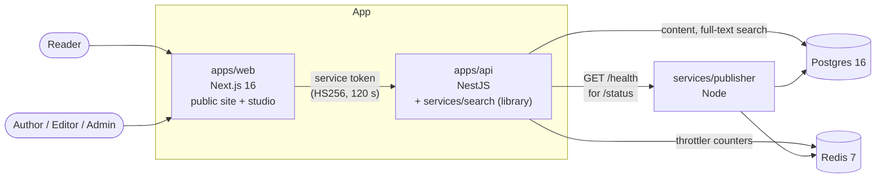
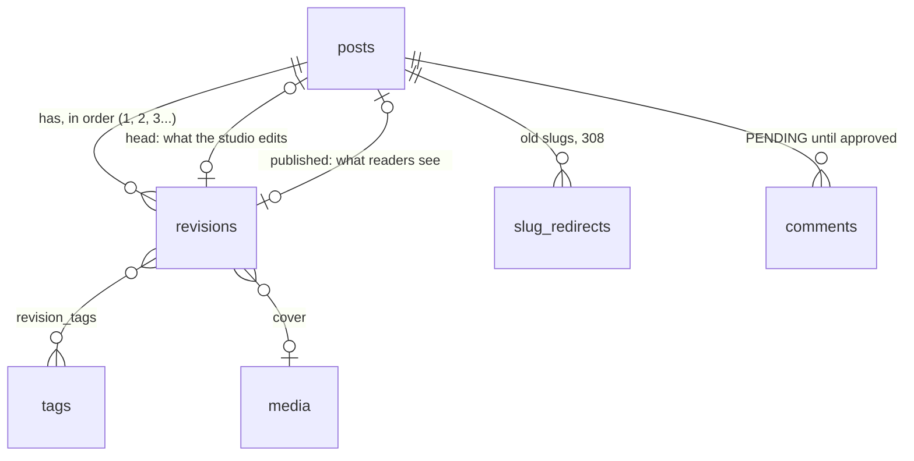

# headless-cms: markdown in, static pages out, updated the moment an editor publishes

[](https://github.com/bastian-red/headless-cms/actions/workflows/ci.yml)

A headless content system with its own public blog. Authors write markdown in a studio, editors
review, schedule and publish, and the public site serves every post as a static page that is
revalidated by tag the moment a publish lands, with no rebuild. A versioned content API serves the
same published content to any other frontend, and the public site reads through it like any other
client. Nothing unpublished may ever reach a page, a feed, a sitemap or a search result.

> **Status: build step 5 of 11, search.** Sign-in, the three roles, the publisher process, health
> and status, every test lane and CI are in place, and so are the content schema, a seeded demo
> publication of forty posts, the one sanitizing markdown renderer, the API (posts and revisions
> with stale-save conflicts, the editorial workflow, content API v1 and API keys) and full-text
> search over published posts, benchmarked at p95 33 ms over 2,000 of them. The rendering matrix,
> SEO, comments, the studio editor and the visual identity arrive in the following steps. This README is rewritten as each one lands (demo GIF included at the end);
> nothing below describes a feature that is not in the code.



The browser only ever talks to `apps/web`. The web tier holds no database credentials (a lint rule
refuses `@cms/db`, Prisma, Redis and BullMQ imports there), so every read of content goes through
the same API an outside client would use.

## What is in the scaffold

- **Sign-in, no sign-up.** Accounts are made by an admin; a public sign-up form on a newsroom's
  tool is an open door. Auth.js keeps the session in a cookie, and the API answers
  `POST /auth/sign-in` after the same scrypt work for an unknown address as for a wrong password,
  so the answer cannot be read off the clock.
- **Three roles as data.** `AUTHOR`, `EDITOR`, `ADMIN` and what each may do live in one table in
  `packages/shared/src/contracts/roles.ts`, read by the API, the studio and the tests. The studio
  shows the role the API reads from Postgres (`GET /auth/me`), not the copy in the session, so a
  demotion takes effect on the next page load.
- **Default-closed API.** Every route needs a service token unless it is marked `@Public()`.
- **Rate limits scoped to what they protect.** Sign-in is capped at 5 a minute per address and
  comments (from step 8) at 10. The tests prove the sign-in budget limits sign-in and nothing else,
  because `@nestjs/throttler` v6 applies every named budget to every route unless it is skipped.
- **Operability.** `GET /health` on the API and the publisher runs a real `SELECT 1` and `PING`, and
  answers 503 naming the failing check. `/status` shows both, fed by the API.
- **A static front page that stays static.** `scripts/render-check.mjs` reads the build's prerender
  manifest and fails the E2E lane if `/` (or any route planned as static) starts rendering per
  request. That is the failure a single `cookies()` call in a shared layout causes, and no
  content-level test would notice it.

## The content model

Content is data, not pages. A **post** is an identity: its slug, its workflow state and two pointers.
Everything a reader sees lives in a **revision**, and revisions are immutable.



- **Readers see the published revision, never the newest one.** A live post being edited is in
  `DRAFT` while readers keep reading the old revision. Tags hang off the revision, so retagging a
  draft cannot change a public tag page before the draft is published.
- **The database enforces the rules, not only the API.** Each of these is a constraint or trigger,
  and `packages/db/test/schema.test.ts` attempts every forbidden write against a real Postgres and
  asserts it is refused by name:
  - a revision cannot be updated, and cannot be deleted while its post exists;
  - a post's head and published revisions, and a revision's parent, must belong to that post;
  - `PUBLISHED` means the head is live, `UNPUBLISHED` means nothing is, `DRAFT` / `IN_REVIEW` /
    `SCHEDULED` mean there is pending work, and a scheduled time exists exactly when scheduled;
  - two saves from the same base cannot both become revision n+1;
  - a redirect can never shadow a live slug, from either side, even when the two writes race (an
    advisory lock per slug; the test proves the second writer waited);
  - slug format and every length limit, with the numbers pinned to `@cms/shared` by a gate test.
- **The seed is a fixture, and it is checked.** Forty posts in every workflow state (one of them
  3,400 words), history, a renamed post with its redirect, a deliberately hostile post, and comments
  in every moderation state. Every row readers must never see carries a canary word.
  `./scripts/seed-check.sh` seeds twice and fails unless both runs digest identically, no canary is
  in any row the public site may read, and every internal link in a live post resolves.

## One markdown renderer

`packages/markdown` is the only code that turns markdown into anything. The studio preview, the post
page, the RSS feed and the search index all call its `render()`, so an editor previews exactly what
a reader and a feed reader get.

```
source ─ remark-parse + GFM ─ headings shifted below the page's h1 ─ remark-rehype ─┐
         (raw HTML dropped here, never escaped into the page)                       │
  ┌─────────────────────────────────────────────────────────────────────────────────┘
  └ rehype-sanitize (GitHub's schema, narrowed) ─ heading ids, footnote links, lazy images
    ─ audit: an independent walk that throws on any unsafe node ─ tree
         ├─ toReact()    page and studio preview: React elements, no innerHTML anywhere
         ├─ renderHtml() RSS (with absolute URLs)
         └─ text         search index
```

- **Sanitized, then audited.** `rehype-sanitize` removes everything outside the policy, and a
  separate audit (`src/audit.ts`, which reads URLs the way a browser does, control characters and
  tabs included) refuses the tree if anything got through. A pipeline that lost its sanitizer
  fails to render instead of serving script; a test proves it.
- **Tested against what a browser would parse.** 46 hostile vectors (raw script, `onerror`,
  `javascript:` with mixed case, entities, tabs and control characters, reference links, attribute
  break-outs, mutation-XSS shapes) plus a property test over random hostile markdown. Each output
  is re-parsed by parse5 and must hold nothing executable and give back exactly the tree that was
  serialized. The seeded hostile post renders to a reviewed snapshot.
- **The same document everywhere.** For every seeded post and every vector, the React path and the
  HTML path parse to the same document. That check found a real difference (`data-footnotes`
  rendered as `="true"` by React and bare by the HTML serializer), now settled in the renderer.
- **No DOM clobbering.** An element id becomes a property of `window`. Heading ids come from the
  shared `slugify` (`[a-z0-9-]`, so `## __next_f` gets `next-f`), and footnote ids carry the
  sanitizer's `user-content-` prefix exactly once, so footnote links work with no script.
- **A time limit on save.** The parser is not linear on every input. Measured: 16,000 characters
  of alternating emphasis take 8 s, 400 nested list levels take 4.8 s, and 8,000 nested quotes
  overflow the stack. `@cms/markdown/server` renders a body in a worker thread with a 2 s
  deadline and terminates it on overrun. From step 4 the API refuses to save a body that fails,
  so pages only ever render bodies that finished in time.

## The API

Two audiences, two front doors, one rule underneath: every write locks the post row and checks the
revision the client says it started from.

### Studio API (`/studio`, signed in)

| Route                                                          | Needs                      | What it does                                                                                              |
| -------------------------------------------------------------- | -------------------------- | --------------------------------------------------------------------------------------------------------- |
| `GET/POST /studio/posts`                                       | `post.read` / `post.write` | List (an author sees only their own), create with revision 1                                              |
| `GET /studio/posts/:id`, `.../revisions`, `.../revisions/:rid` | `post.read`                | The post with its head, the history, one revision                                                         |
| `POST /studio/posts/:id/revisions`                             | `post.write`               | Save: `baseRevisionId` + fields. 201 new head, 200 nothing changed, 409 stale, 422 does not render        |
| `POST /studio/posts/:id/revisions/:rid/restore`                | `post.restore`             | Restore = a new revision with the old content; history is never rewritten                                 |
| `PUT /studio/posts/:id/slug`                                   | `post.write`               | Rename; renaming a post that was ever public is an editor's call and leaves a 308 behind                  |
| `POST /studio/posts/:id/transitions`                           | per action                 | `submit`, `withdraw`, `publish`, `schedule`, `unschedule`, `unpublish`, pinned to the head the caller saw |
| `GET/POST /studio/tags`                                        | `post.read` / `tag.manage` |                                                                                                           |
| `GET/POST /studio/users`, `PATCH .../:id/role`                 | `user.manage`              | The last admin cannot be demoted                                                                          |
| `GET/POST/DELETE /studio/api-keys`                             | `apikey.manage`            | A key is shown once and stored as a SHA-256                                                               |

- **A stale save is a 409 that says what happened.** Five editors saving from the same base:
  one wins and four get `409` with the winning revision, the fields that differ and a unified diff
  of the body (`details.bodyPatch`). The row lock (`SELECT ... FOR UPDATE`) is what makes that
  answer possible: without it the losers hit the unique revision number instead and learn nothing.
- **A body that does not render in time is a 422, before anything is written.** Every save and
  restore runs the body through `@cms/markdown/server`'s `RenderChecker` (one worker, 2 s
  deadline). A pathological body is refused with `details.render: "timeout"` and the next save
  works, so a post can never hold a body the page cannot render.
- **An editor publishes exactly what they reviewed.** A transition names `revisionId`; if the head
  moved since, it is a 409 and nothing changes. Publishing needs an excerpt (it is the feed
  summary and the meta description), a schedule must be at least a minute ahead, an author's save
  cannot touch a scheduled post, and an editor's save cancels the schedule.
- **Somebody else's post is 404, not 403**, for an author, on every route.
- **The role is read from the database on every request**, never from the token, so a demotion
  takes effect on the next call rather than when the two-minute token expires.
- **Every change readers can see writes its cache tags in the same transaction.** Publish,
  unpublish and renaming a live post insert a `revalidation_events` row (`posts`, `post:<slug>`,
  `tag:<slug>`, `author:<id>`) that the publisher delivers from step 7. A save or a submit writes
  none: nothing public changed.

### Content API v1 (`/v1`, API key)

`Authorization: Bearer hcms_...`, issued by an admin in the studio. Missing, malformed, unknown,
revoked and studio-token credentials all get the same 401.

| Route                                       | Answer                                                                                                                                                                               |
| ------------------------------------------- | ------------------------------------------------------------------------------------------------------------------------------------------------------------------------------------ |
| `GET /v1/posts?tag=&author=&limit=&cursor=` | Live posts, newest first, keyset-paginated (`nextCursor`)                                                                                                                            |
| `GET /v1/posts/:slug`                       | The published revision as markdown and as sanitized HTML, with outline, words and reading time; `308` + `Location` from an old slug; `410` if taken down; `404` if it never went out |
| `GET /v1/tags`                              | Tags on at least one live post, with counts                                                                                                                                          |
| `GET /v1/search?q=&limit=&cursor=`          | Live posts matching `q`, title hits first, with `total` and a snippet as data; see [Search](#search)                                                                                 |
| `GET /v1/openapi.json`                      | The OpenAPI 3 document, public, generated from the same zod schemas the tests parse responses with                                                                                   |

- **Drafts have no road out.** Every query reads `published_revision_id`; nothing in the content
  service selects the head. The integration suite crawls every page, post and tag for the seed's
  canary words and fails on one, including on the post whose pending draft holds them.
- **`ETag` on every 200**, `304` on a matching `If-None-Match`, `Cache-Control: no-cache`.
- **Per-key rate limits.** A key is its own budget, so the public site and a second frontend
  never share one.
- **A draft and nothing at all answer byte for byte the same 404**, so the API does not disclose
  what is being written.

## Search

`GET /v1/search?q=edge+caching` answers from Postgres full-text search, in the database the content
already lives in ([`services/search`](services/search/README.md) has the whole design and its
measurements):

```json
{
  "query": "edge caching",
  "total": 2,
  "nextCursor": null,
  "items": [
    {
      "slug": "caching-at-the-edge-a-year-in",
      "title": "Caching at the edge, a year in",
      "...": "...",
      "snippet": [
        { "text": "A year ago we put a ", "match": false },
        { "text": "cache", "match": true },
        { "text": " in front of every public", "match": false }
      ]
    }
  ]
}
```

- **Only published text can match**, held three ways: the database keeps each revision's
  document `live` exactly while it is the published one (triggers, a forged flag is undone), the
  query also joins the published pointer, and the API keeps a hit only if it still is.
- **What is indexed is what readers read:** the renderer's text, never the markdown source, so the
  hostile post's `<script>` payload is not findable.
- **A title match always outranks a body-only match.** It is the first sort key, not a weight,
  because weights alone invert (the suite builds the case).
- **The query syntax readers already type:** `"a phrase"`, `or`, `-without`, never a syntax
  error. Snippets are `[{ text, match }]`, so no client has to trust HTML from a search result.
- **p95 33 ms over 2,000 published posts** (`pnpm search:bench`, a CI step, budget 50 ms), with
  the common words matching every post. The first design measured 513 ms; the README in
  `services/search` says what each step bought.

## Running it

Requires Node 20+, pnpm 9 and Docker.

```bash
pnpm install
cp .env.example .env
sed -i "s|^AUTH_SECRET=|AUTH_SECRET=$(openssl rand -base64 32)|" .env
docker compose -f infra/docker-compose.yml up -d     # Postgres :5444, Redis :6390
pnpm db:deploy && pnpm db:seed                        # the seed writes search documents too
pnpm dev                                              # web :3000, api :4000, publisher :4400
```

Open <http://localhost:3000/studio> and sign in with a seeded account (local accounts for a local
database, published on purpose):

| Role   | Email              | Password               |
| ------ | ------------------ | ---------------------- |
| Admin  | `ines@quire.test`  | `admin-password-2026`  |
| Editor | `tomas@quire.test` | `editor-password-2026` |
| Author | `mara@quire.test`  | `author-password-2026` |

The whole stack in containers: `docker compose -f infra/docker-compose.yml --profile app up -d --build`.

`pnpm dev` runs `scripts/dev.sh`, which loads `.env`, checks `AUTH_SECRET` and that Postgres and
Redis answer, then starts turbo. Turbo reads no `.env` itself and runs in strict environment mode,
so without the wrapper the API would boot with no secret.

## Testing

| Lane                 | Command                       | What it proves                                                                                                                                                                                                                                                                                                                                                                                                                                                                                                                                                                                                                                                                                                                                                                                                                                                   |
| -------------------- | ----------------------------- | ---------------------------------------------------------------------------------------------------------------------------------------------------------------------------------------------------------------------------------------------------------------------------------------------------------------------------------------------------------------------------------------------------------------------------------------------------------------------------------------------------------------------------------------------------------------------------------------------------------------------------------------------------------------------------------------------------------------------------------------------------------------------------------------------------------------------------------------------------------------- |
| Gate (every commit)  | `pnpm test`                   | The markdown renderer against 46 hostile vectors, a property test and the whole seeded publication, with the page and feed outputs identical; contracts, role matrix, the workflow table against every state the database allows, stale-save diffs, cursors, ETags, service tokens (incl. the `alg: none` forgery), config parsing, error mapping, throttler scoping, contrast of every colour pair in both schemes, no dangling CSS tokens, no `innerHTML`                                                                                                                                                                                                                                                                                                                                                                                                      |
| Environment contract | `pnpm env:contract`           | Source, `.env.example` and `turbo.json` agree in all four directions                                                                                                                                                                                                                                                                                                                                                                                                                                                                                                                                                                                                                                                                                                                                                                                             |
| Seed check           | `./scripts/seed-check.sh`     | The seed is deterministic and idempotent (two runs, one digest), every workflow state exists, no canary word is in a public row or a live search document, one live search document per live post, every internal link in a live post resolves                                                                                                                                                                                                                                                                                                                                                                                                                                                                                                                                                                                                                   |
| Integration          | `./scripts/integration.sh`    | Every content-model constraint and trigger refusing its forbidden write by name (including a two-transaction race) and the search documents' `live` flag following every publish, then the search query on the seeded corpus (title tier, no draft or canary findable, query syntax, every snippet path, cursor crawl), then the seeded newsroom behind the real Nest graph on Postgres and Redis at the documented budgets: sign-in and the default-closed guard; every studio route against every role (403 exactly where the role table says no, before the body is read); the five-way stale-save race; the render deadline; every workflow transition and its outbox row; the content API's pagination, filters, ETags, 308/410/404 and a canary crawl of every response; the OpenAPI document matching the router; the last-admin race; API key revocation |
| Search bench         | `pnpm search:bench`           | p95 < 50 ms over 2,000 published posts and 4,500 documents, 25 query shapes, through the exact function `/v1/search` calls; the GIN index used by a selective query                                                                                                                                                                                                                                                                                                                                                                                                                                                                                                                                                                                                                                                                                              |
| Red proofs           | `node scripts/red-proofs.mjs` | Breaks each guarantee in the source (the row lock, the head check, the excerpt rule, the outbox row, key revocation, the fresh role, the last-admin lock, the published-only query, tag order, weak ETags; for search the title tier, both draft defenses, the exclusion rule, the snippet window's check, the cursor binding, control-character stripping, and the first design's ranking against the bench), runs the suite that claims it, and fails unless that suite goes red                                                                                                                                                                                                                                                                                                                                                                               |
| E2E                  | `./scripts/e2e.sh`            | Production build, the rendering matrix, Chromium and Firefox: sign-in per role, deep links, open-redirect refusal, health and status, axe (zero violations, both schemes), no sideways scroll at 390 px                                                                                                                                                                                                                                                                                                                                                                                                                                                                                                                                                                                                                                                          |
| Dev smoke            | `./scripts/dev-smoke.sh`      | The documented `pnpm dev` from a cold start, with every `.env` name stripped from its own environment, serves a studio that read the editor from Postgres                                                                                                                                                                                                                                                                                                                                                                                                                                                                                                                                                                                                                                                                                                        |

The pre-commit hook runs gitleaks, the environment contract, the invisible-character scan, prettier
and the gate lane. CI runs every lane above plus lint, typecheck, a dependency audit and the three
Docker image builds.

## Configuration

Every variable is documented in [`.env.example`](.env.example). `node scripts/env-contract.mjs`
fails if the code reads a name that `turbo.json` does not pass through or `.env.example` does not
document.

## Layout

```
apps/web            Next.js 16: the public site and the studio
apps/api            NestJS: auth, studio API (posts, revisions, workflow, tags, users, keys), content API v1 and search, health, status
services/search     Postgres full-text search: the query, ranking, snippets, cursors, reindex
services/publisher  publish delivery and scheduling (health only until step 7)
packages/markdown   the one renderer: parse, sanitize, audit; React, HTML and text out
packages/db         Prisma schema, migrations, the seeded publication, schema tests
packages/shared     zod contracts, roles, error vocabulary, service tokens
packages/config     shared tsconfig
infra/              docker-compose and one Dockerfile per process
e2e/                Playwright
scripts/            dev launcher, lane scripts, contract and render checks
```
